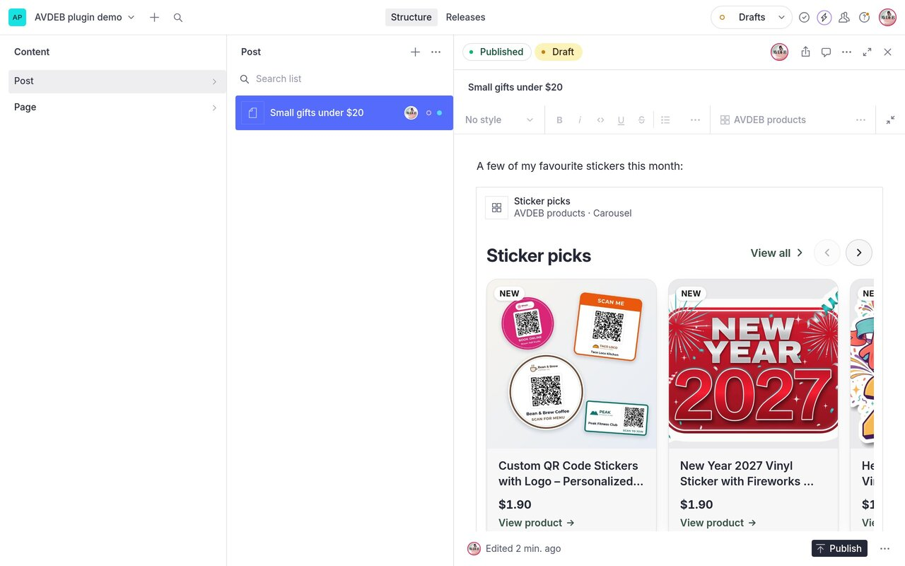

# AVDEB Products for Sanity

Show [AVDEB](https://avdeb.com/developers/#sanity) products in your Sanity content (a creator's shop, a category, a search or a single product) with **your affiliate referral code on every link**.



- **Studio blocks with a live preview:** *AVDEB products*, *AVDEB product* and *AVDEB button* objects for Portable Text and page builders. Editors see the real products while they edit, and can search AVDEB to pick a product.
- **Any front end:** React components for `@portabletext/react` (server components or prerendered), a `toHTML` helper for `@portabletext/to-html`, and a framework-free renderer for everything else.
- **Four layouts:** grid, carousel (scroll-snap with keyboard and arrow buttons), list ("shop the post") and spotlight. Single products render as a horizontal card, a hero or a compact card, with your own badge and note.
- **Fits your design:** container queries let embeds adapt to the column they sit in. Choose inherit, light, dark or system theme, plus card style, accent colour, radius and image shape. Styles use `:where()` (zero specificity), so your CSS always wins, and `--avdeb-*` custom properties restyle everything. Or use `avdeb.data()` for your own markup.
- **Fast and resilient:** products are fetched on your server and cached in memory. If AVDEB can't be reached, the last good copy is shown for a week. Only the carousel needs a script, and it's tiny.
- **Honest links:** referral links get `rel="sponsored"`, and an optional affiliate disclosure appears under embeds that carry a code.
- **Private by default:** no third-party scripts, cookies, iframes or tracking. The secret key stays on your server and is never part of the Studio.

## Requirements

- Sanity Studio 5 or 6
- Any JavaScript front end (Node 20.19+, edge runtimes, Deno, Bun or the browser). The React components need React 19.

## Installation

```sh
npm install sanity-plugin-avdeb
```

Install it in your Studio and in your front end (or once, if they share a project).

## Studio

Add the plugin to `sanity.config.ts`:

```ts
import { defineConfig } from "sanity";
import { avdeb } from "sanity-plugin-avdeb";

export default defineConfig({
	// …
	plugins: [avdeb()],
});
```

Then add the AVDEB objects to a Portable Text field:

```ts
defineField({
	name: "body",
	type: "array",
	of: [
		defineArrayMember({ type: "block" }),
		defineArrayMember({ type: "avdebProducts" }),
		defineArrayMember({ type: "avdebProduct" }),
		defineArrayMember({ type: "avdebButton" }),
	],
});
```

They work the same way in any array, for example a page builder's `sections`.

- **AVDEB products:** an AVDEB creator, category or product link (`https://avdeb.com/category/stickers/`) or search words, a layout, the number of products, a heading, an intro and a "View all" link. A collapsed *Display* section overrides columns, card style, theme, accent colour, radius, image shape, button text, prices, creator names and new tabs.
- **AVDEB product:** search AVDEB and click a product, or paste a product link. Choose horizontal, hero or compact card, and add a badge ("Editor's pick") and your note.
- **AVDEB button:** a referral button to any avdeb.com page, with a label, style and alignment.

The preview uses the same HTML and stylesheet as your front end. To make it match your site's defaults, pass the same display options to the plugin: `avdeb({ layout: "carousel", accentColor: "#7c3aed" })`.

## Front end

Create one AVDEB runtime on your server:

```ts
// lib/avdeb.ts
import { createAvdeb } from "sanity-plugin-avdeb/render";

export const avdeb = createAvdeb({
	refCode: process.env.AVDEB_REF_CODE,
	// apiKey: process.env.AVDEB_SECRET_KEY,
	// layout: "carousel", accentColor: "#7c3aed", …
});
```

Without options it reads the `AVDEB_REF_CODE` and `AVDEB_SECRET_KEY` environment variables. Query your Portable Text as usual: the AVDEB objects are plain objects, so `body` or `body[]` in GROQ returns everything they need.

### React (Next.js App Router and other server components)

```tsx
import { PortableText } from "@portabletext/react";
import { avdebComponents } from "sanity-plugin-avdeb/react";
import "sanity-plugin-avdeb/avdeb.css"; // once, for example in your root layout

import { avdeb } from "@/lib/avdeb";

export default async function Post({ post }) {
	return <PortableText value={post.body} components={avdebComponents(avdeb)} />;
}
```

The components are async server components: products are fetched on the server, and the page ships plain HTML plus a tiny client component for carousel arrows. To combine them with your own components: `{ types: { ...avdebComponents(avdeb).types, ...myTypes } }`.

### React without server components (Pages Router, Vite, Remix loaders…)

Render the embeds where you load data, then pass the result:

```tsx
// getStaticProps, a loader, a server function…
const embeds = await avdeb.prerender(post.body);

// component
<PortableText value={post.body} components={avdebComponents(embeds)} />
```

### HTML (@portabletext/to-html, Astro, SvelteKit, Vue, Eleventy…)

```ts
import { toHTML } from "@portabletext/to-html";
import { toHTMLComponents } from "sanity-plugin-avdeb/render";

const embeds = await avdeb.prerender(post.body);
const html = toHTML(post.body, { components: toHTMLComponents(embeds) });
```

Or render one object: `await avdeb.block(value)`. Load `sanity-plugin-avdeb/avdeb.css` on pages with products, and `sanity-plugin-avdeb/avdeb.js` (or call `initCarousels()` from `sanity-plugin-avdeb/render`) for carousel arrows. Without the script, carousels still scroll.

### Your own markup

```ts
const result = await avdeb.data(value); // an avdebProducts object, or { tag: "stickers", limit: 4 }
```

`result.cards` holds `href` (with your referral code), `rel`, `target`, `title`, `image`, `width`, `height`, `price`, `compareAt`, `discount`, `isNew` and `creator`. Raw products are in `result.products`, the "view all" link in `result.viewAll`, and the disclosure in `result.disclosure`.

### Options

| Option | Default | |
| --- | --- | --- |
| `refCode` | `AVDEB_REF_CODE` | Your referral code, added as `?ref=` to every link |
| `apiKey` | `AVDEB_SECRET_KEY` | Secret key (`avdeb_sk_…`), server only |
| `layout` | `'grid'` | `grid`, `carousel`, `list`, `spotlight` |
| `columns` | `3` | 1–6 (narrow columns get fewer automatically) |
| `cardStyle` | `'elevated'` | `elevated`, `outline`, `minimal` |
| `theme` | `'site'` | `site` (inherit your colours and fonts), `light`, `dark`, `auto` |
| `accentColor` | AVDEB green | Hex colour for buttons and highlights |
| `radius` | `16` | Corner radius in px (0–32) |
| `imageRatio` | `'square'` | `square`, `portrait`, `landscape` |
| `ctaLabel` | `'View product'` | Button text on cards |
| `showPrice`, `showCreator`, `showBadges` | `true` | Card details |
| `newTab` | `false` | Open product links in a new tab |
| `showDisclosure` | `true` | Affiliate disclosure under embeds that carry a code |
| `disclosureText` | "As an AVDEB affiliate, I earn a commission from qualifying purchases." | |
| `cacheMinutes` | `360` | How long fetched products stay fresh (5–2880) |
| `locale` | `'en-US'` | Price formatting |
| `fetch` | global `fetch` | Your own fetch, for example with framework caching options |

Settings on an object in the Studio win over these defaults. A secret key adds your code automatically and allows up to 48 products per embed (12 without). Never pass `apiKey` to the Studio plugin: the Studio runs in the browser, so the plugin ignores it there.

### Become an AVDEB affiliate

Free to join: 5% commission, 30-day cookie, monthly PayPal payouts in USD ($50 minimum), open worldwide.
Apply at [avdeb.com/affiliate/apply](https://avdeb.com/affiliate/apply/). After approval, copy your referral code (or create a secret key) in the [partner dashboard](https://avdeb.com/affiliate/dashboard/developers/).

## Styling

Every rule is `:where()`-wrapped, so your CSS wins. Set tokens in your stylesheet:

```css
.avdeb {
	--avdeb-accent: #7c3aed;
	--avdeb-radius: 4px;
	--avdeb-card-bg: #fff;
	--avdeb-font-title: Georgia, serif;
}
```

Tokens: `--avdeb-accent`, `--avdeb-accent-contrast`, `--avdeb-surface`, `--avdeb-card-bg`, `--avdeb-card-pad`, `--avdeb-border`, `--avdeb-muted`,
`--avdeb-badge-bg`, `--avdeb-badge-text`, `--avdeb-shadow`, `--avdeb-shadow-hover`, `--avdeb-radius`, `--avdeb-ratio`, `--avdeb-gap`, `--avdeb-pad`,
`--avdeb-font-title`, `--avdeb-heading-size`, `--avdeb-title-size`, `--avdeb-price-size`, `--avdeb-btn-bg`, `--avdeb-btn-color`, `--avdeb-btn-shadow`.

The markup uses stable BEM classes (`.avdeb`, `.avdeb--{layout}`, `.avdeb-card`, `.avdeb-card__title`, `.avdeb-card__price`, `.avdeb-btn`…). The React components wrap each embed in `<div class="avdeb-embed">`; pass `avdebComponents(avdeb, { className })` to add your own class.

## How it works

- Your front end calls `https://api.avdeb.com/v1/catalog/products`. With a secret key, requests send `Authorization: Bearer avdeb_sk_…` and the API returns links that already carry your code; without one, `?ref=` is added to every link.
- Each query is cached in memory for `cacheMinutes`; a failed request falls back to the last good result (up to a week old) and retries after 15 minutes. Identical embeds rendered at the same time share one request. On serverless hosts each instance has its own cache, so pair it with your framework's page caching (ISR, `revalidate`) to keep pages fast.
- The Studio preview calls the same public API from the editor's browser, never with a secret key. The plugin only adds object types to your schema: no document actions, no tokens, nothing written to your dataset.
- All product data is validated before rendering: only `https://avdeb.com` links and `https://` images get through, and every value is escaped.

## Development

```sh
npm test               # unit tests: catalog client, options, renderer, Portable Text helpers, React components
npm run typecheck      # the type declarations against a usage sample
npm run dev            # dev Studio (set SANITY_STUDIO_PROJECT_ID in studio/.env)
npm run build:css      # after editing assets/avdeb.css: refreshes the Studio preview's copy
```

## Support

Issues and ideas: [github.com/Avdebcom/sanity-plugin-avdeb/issues](https://github.com/Avdebcom/sanity-plugin-avdeb/issues). More integrations: [avdeb.com/developers](https://avdeb.com/developers/).

## License

MIT © AVDEB
